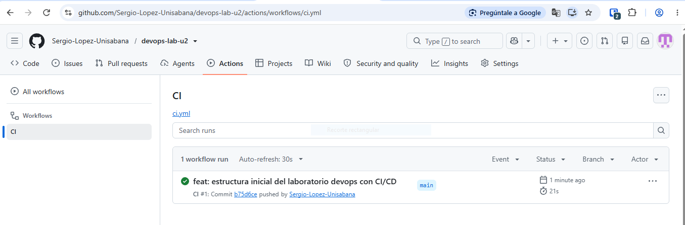
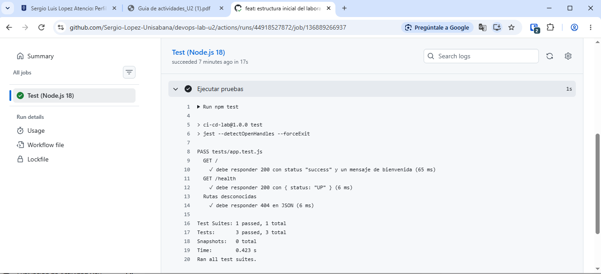

# Universidad de La Sabana

## Fundamentos DevOps

### Unidad 2 — Actividad 3: Laboratorio técnico

**Implementación de un microservicio Node.js/Express con pipeline CI/CD automatizado (GitHub Actions + Jenkins + Docker Hub)**

| Campo | Detalle |
|---|---|
| **Estudiante** | Sergio Luis López Atencio |
| **Curso** | Fundamentos DevOps |
| **Institución** | Universidad de La Sabana |
| **Unidad** | Unidad 2 — Actividad 3: Laboratorio técnico |
| **Repositorio GitHub** | https://github.com/Sergio-Lopez-Unisabana/devops-lab-u2 |
| **Fecha** | Noviembre de 2026 |

---

## Tabla de contenido

1. [Introducción y contexto](#1-introducción-y-contexto)
2. [Arquitectura de la aplicación y pruebas](#2-arquitectura-de-la-aplicación-y-pruebas)
3. [Pipeline de Integración Continua (GitHub Actions)](#3-pipeline-de-integración-continua-github-actions)
4. [Pipeline de Despliegue Continuo (Jenkins)](#4-pipeline-de-despliegue-continuo-jenkins)
5. [Conclusiones técnicas](#5-conclusiones-técnicas)
6. [Referencias](#6-referencias)

---

## 1. Introducción y contexto

El presente laboratorio tiene como propósito implementar un **microservicio en Node.js con Express** y dotarlo de un flujo completo de **Integración Continua (CI)** y **Despliegue Continuo (CD)**. El objetivo no es únicamente que la aplicación funcione de forma local, sino demostrar que el código puede validarse, empaquetarse y publicarse de manera automática, repetible y auditable cada vez que se integra un cambio en la rama principal.

Para cumplir con este objetivo se articulan cuatro piezas tecnológicas:

- **Node.js + Express** como plataforma del microservicio, con dos endpoints mínimos: `GET /` y `GET /health`.
- **Jest + Supertest** como framework de pruebas automatizadas, encargado de validar el contrato HTTP de la aplicación sin necesidad de levantar un servidor persistente.
- **GitHub Actions** como motor de Integración Continua, que ejecuta las pruebas en cada `push` y `pull_request` dirigido a `main`.
- **Jenkins + Docker** como motor de Despliegue Continuo, que construye la imagen del servicio y la publica en **Docker Hub** con una etiqueta basada en el número de build.

El resultado es una cadena en la que la calidad se convierte en una **compuerta automática**: si las pruebas fallan, el pipeline se detiene y no se genera un artefacto desplegable. Si las pruebas pasan, la imagen se construye y se publica, garantizando que lo que llega al registro es exactamente lo que fue validado.

### 1.1. Alcance del laboratorio

| Elemento | Alcance |
|---|---|
| Aplicación | Microservicio HTTP con Express y dos endpoints funcionales |
| Pruebas | Pruebas unitarias/de contrato con Jest y Supertest |
| CI | Workflow de GitHub Actions sobre `push` y `pull_request` a `main` |
| CD | Pipeline declarativo de Jenkins con build y push a Docker Hub |
| Empaquetado | Imagen Docker basada en `node:18-alpine`, ejecutada como usuario sin privilegios |
| Evidencias | Capturas del workflow de CI y del detalle de las pruebas en Jest; código completo del `Jenkinsfile` |

---

## 2. Arquitectura de la aplicación y pruebas

### 2.1. Estructura del proyecto

```text
devops-lab-u2/
├── .github/
│   └── workflows/
│       └── ci.yml          # Pipeline de Integración Continua
├── docs/
│   └── images/             # Evidencias gráficas del laboratorio
├── tests/
│   └── app.test.js         # Pruebas con Jest + Supertest
├── app.js                  # Definición de la aplicación Express
├── server.js               # Arranque del servidor y apagado ordenado
├── Dockerfile              # Empaquetado de la imagen
├── Jenkinsfile             # Pipeline de Despliegue Continuo
├── package.json
└── package-lock.json
```

La separación entre `app.js` y `server.js` es una decisión de diseño deliberada: **`app.js` exporta la instancia de Express sin abrir un puerto**, mientras que `server.js` es el único responsable de llamar a `app.listen()`. Esta separación permite que las pruebas importen la aplicación directamente, sin dejar procesos ni sockets abiertos, lo que evita bloqueos durante la ejecución de Jest.

### 2.2. Endpoints implementados

| Método | Ruta | Código | Respuesta | Propósito |
|---|---|---|---|---|
| `GET` | `/` | `200` | `{ "status": "success", "message": "Bienvenido al laboratorio CI/CD..." }` | Endpoint raíz de bienvenida y verificación funcional |
| `GET` | `/health` | `200` | `{ "status": "UP" }` | Sonda de salud para Docker, balanceadores y orquestadores |
| `*` | Cualquier otra | `404` | `{ "status": "error", "message": "Ruta no encontrada: ..." }` | Manejo uniforme de rutas inexistentes en formato JSON |

El endpoint `/health` es especialmente relevante en un contexto DevOps porque permite que herramientas externas determinen si el contenedor está operativo. En el `Dockerfile` se consume mediante un `HEALTHCHECK` nativo:

```dockerfile
HEALTHCHECK --interval=30s --timeout=3s --start-period=5s --retries=3 \
  CMD wget -qO- http://127.0.0.1:3000/health || exit 1
```

### 2.3. Definición de la aplicación

```javascript
const express = require('express');

const app = express();

app.use(express.json());
app.disable('x-powered-by');

app.get('/', (req, res) => {
  res.status(200).json({
    status: 'success',
    message: 'Bienvenido al laboratorio CI/CD con Node.js, Express y Docker',
  });
});

app.get('/health', (req, res) => {
  res.status(200).json({ status: 'UP' });
});

app.use((req, res) => {
  res.status(404).json({
    status: 'error',
    message: `Ruta no encontrada: ${req.method} ${req.originalUrl}`,
  });
});

module.exports = app;
```

Adicionalmente, `server.js` implementa un **apagado ordenado** ante las señales `SIGTERM` y `SIGINT`, de modo que el contenedor cierra sus conexiones de forma limpia antes de terminar. Esta práctica evita cortes abruptos durante despliegues y reinicios.

### 2.4. Pruebas unitarias con Jest y Supertest

Las pruebas se ejecutan con **Jest** como runner y **Supertest** como cliente HTTP en memoria. Supertest toma la instancia exportada de `app.js` y levanta un servidor efímero en un puerto aleatorio durante cada aserción, cerrándolo al finalizar. Gracias a ello, las pruebas son rápidas, deterministas y **no bloquean el proceso**.

```javascript
const request = require('supertest');
const app = require('../app');

describe('GET /', () => {
  it('debe responder 200 con status "success" y un mensaje de bienvenida', async () => {
    const response = await request(app).get('/');

    expect(response.status).toBe(200);
    expect(response.headers['content-type']).toMatch(/application\/json/);
    expect(response.body).toEqual({
      status: 'success',
      message: expect.any(String),
    });
    expect(response.body.message.length).toBeGreaterThan(0);
  });
});

describe('GET /health', () => {
  it('debe responder 200 con { status: "UP" }', async () => {
    const response = await request(app).get('/health');

    expect(response.status).toBe(200);
    expect(response.headers['content-type']).toMatch(/application\/json/);
    expect(response.body).toEqual({ status: 'UP' });
  });
});

describe('Rutas desconocidas', () => {
  it('debe responder 404 en JSON', async () => {
    const response = await request(app).get('/no-existe');

    expect(response.status).toBe(404);
    expect(response.body.status).toBe('error');
  });
});
```

La configuración de Jest en `package.json` refuerza esta garantía:

```json
"scripts": {
  "start": "node server.js",
  "dev": "node --watch server.js",
  "test": "jest --detectOpenHandles --forceExit"
},
"jest": {
  "testEnvironment": "node",
  "verbose": true,
  "testMatch": ["**/tests/**/*.test.js"]
}
```

- `testEnvironment: "node"` evita el entorno de navegador simulado, innecesario para un servicio backend.
- `--detectOpenHandles` advierte si alguna prueba deja recursos abiertos (timers, sockets, conexiones).
- `--forceExit` actúa como red de seguridad para que el runner finalice incluso ante un handle residual.
- `verbose: true` produce una salida detallada por caso de prueba, útil como evidencia en los registros del pipeline.

---

## 3. Pipeline de Integración Continua (GitHub Actions)

### 3.1. Definición del workflow

El workflow se encuentra en `.github/workflows/ci.yml` y se activa en cada `push` y `pull_request` dirigido a la rama `main`:

```yaml
name: CI

on:
  push:
    branches: [main]
  pull_request:
    branches: [main]

permissions:
  contents: read

concurrency:
  group: ci-${{ github.ref }}
  cancel-in-progress: true

jobs:
  test:
    name: Test (Node.js 18)
    runs-on: ubuntu-latest

    steps:
      - name: Checkout del código
        uses: actions/checkout@v4

      - name: Configurar Node.js 18 con caché de npm
        uses: actions/setup-node@v4
        with:
          node-version: 18
          cache: npm

      - name: Instalar dependencias (npm ci)
        run: npm ci

      - name: Ejecutar pruebas
        run: npm test
```

### 3.2. Explicación de los componentes

| Componente | Función |
|---|---|
| `on.push` / `on.pull_request` | Dispara el pipeline al integrar cambios o al proponerlos mediante PR hacia `main`. |
| `permissions: contents: read` | Aplica el principio de mínimo privilegio: el job solo puede leer el repositorio. |
| `concurrency` | Agrupa las ejecuciones por referencia y cancela las obsoletas, evitando consumir minutos innecesarios. |
| `actions/checkout@v4` | Descarga el código de la rama o del PR en el runner. |
| `actions/setup-node@v4` | Instala Node.js 18 y habilita la caché de npm, acelerando ejecuciones posteriores. |
| `npm ci` | Instala dependencias exactamente según `package-lock.json`, garantizando builds reproducibles. |
| `npm test` | Ejecuta Jest; un fallo aquí marca el workflow como fallido y bloquea la integración. |

El uso de `npm ci` en lugar de `npm install` es una decisión técnica relevante: `npm ci` instala de forma determinista a partir del lockfile, falla si el lockfile y el `package.json` están desincronizados y no modifica el árbol de dependencias. Esto elimina la variabilidad entre ejecuciones.

### 3.3. Evidencias

**Figura 1.** Ejecución exitosa del workflow de Integración Continua en GitHub Actions.



*Figura 1. Ejecución exitosa del workflow `CI` en GitHub Actions, con los pasos de checkout, configuración de Node.js, instalación de dependencias y ejecución de pruebas completados correctamente.*

**Figura 2.** Detalle de las pruebas unitarias ejecutadas con Jest.



*Figura 2. Salida detallada de Jest (`verbose: true`) donde se observan los casos de prueba de `GET /`, `GET /health` y el manejo de rutas desconocidas, todos en estado aprobado.*

---

## 4. Pipeline de Despliegue Continuo (Jenkins)

### 4.1. Descripción general

El pipeline de Despliegue Continuo se implementa mediante un **`Jenkinsfile` declarativo** escrito en Groovy. Su responsabilidad es tomar el código validado, construir una imagen Docker, etiquetarla y publicarla en Docker Hub. A diferencia del pipeline de CI, aquí no se incluye captura de pantalla: la evidencia es el propio código del pipeline, que se presenta íntegro a continuación.

### 4.2. Variables de entorno

| Variable | Valor | Descripción |
|---|---|---|
| `DOCKERHUB_CREDENTIALS` | `dockerhub-credentials` | ID de la credencial de Jenkins de tipo *Username with password*, que almacena el usuario y el token de Docker Hub. |
| `DOCKERHUB_USER` | `TU_USUARIO_DOCKERHUB` | Nombre de usuario en Docker Hub (valor de ejemplo que debe reemplazarse). |
| `IMAGE_NAME` | `ci-cd-lab` | Nombre base de la imagen. |
| `IMAGE_TAG` | `${env.BUILD_NUMBER}` | Etiqueta única por build, lo que permite trazabilidad y versionado inmutable. |
| `IMAGE_FULL` | `${DOCKERHUB_USER}/${IMAGE_NAME}:${IMAGE_TAG}` | Referencia completa de la imagen versionada. |
| `IMAGE_LATEST` | `${DOCKERHUB_USER}/${IMAGE_NAME}:latest` | Etiqueta móvil que apunta a la última imagen publicada. |

El uso de `${BUILD_NUMBER}` como etiqueta garantiza que **cada build produzca un artefacto identificable y no sobrescribible**, mientras que la etiqueta `latest` facilita el consumo por parte de entornos que siempre requieren la versión más reciente.

### 4.3. Código completo del Jenkinsfile

```groovy
pipeline {
    agent any

    environment {
        // Credencial de Jenkins (tipo "Username with password") con el usuario y token de Docker Hub.
        DOCKERHUB_CREDENTIALS = 'dockerhub-credentials'
        DOCKERHUB_USER         = 'TU_USUARIO_DOCKERHUB'
        IMAGE_NAME             = 'ci-cd-lab'
        IMAGE_TAG              = "${env.BUILD_NUMBER}"
        IMAGE_FULL             = "${DOCKERHUB_USER}/${IMAGE_NAME}:${IMAGE_TAG}"
        IMAGE_LATEST           = "${DOCKERHUB_USER}/${IMAGE_NAME}:latest"
    }

    options {
        timestamps()
        disableConcurrentBuilds()
        buildDiscarder(logRotator(numToKeepStr: '10'))
    }

    stages {
        stage('Checkout Source') {
            steps {
                echo "=== [1/3] Obteniendo código fuente (rama ${env.BRANCH_NAME ?: 'main'}) ==="
                checkout scm
                sh 'git rev-parse --short HEAD'
            }
        }

        stage('Build Docker Image') {
            steps {
                echo "=== [2/3] Construyendo imagen ${env.IMAGE_FULL} ==="
                sh """
                    docker build \
                        --label "org.opencontainers.image.revision=${env.GIT_COMMIT}" \
                        --label "org.opencontainers.image.created=\$(date -u +%Y-%m-%dT%H:%M:%SZ)" \
                        -t "${env.IMAGE_FULL}" \
                        -t "${env.IMAGE_LATEST}" \
                        .
                """
                sh "docker image inspect ${env.IMAGE_FULL} --format '{{.Id}} {{.Size}} bytes'"
            }
        }

        stage('Push to Registry') {
            steps {
                echo "=== [3/3] Publicando imagen en Docker Hub ==="
                withCredentials([usernamePassword(
                    credentialsId: env.DOCKERHUB_CREDENTIALS,
                    usernameVariable: 'DOCKER_USER',
                    passwordVariable: 'DOCKER_PASS'
                )]) {
                    sh '''
                        echo "$DOCKER_PASS" | docker login -u "$DOCKER_USER" --password-stdin
                    '''
                    sh """
                        docker push "${env.IMAGE_FULL}"
                        docker push "${env.IMAGE_LATEST}"
                    """
                    sh 'docker logout'
                }
            }
        }
    }

    post {
        success {
            echo "Pipeline completado. Imagen publicada: ${env.IMAGE_FULL} y ${env.IMAGE_LATEST}"
        }
        failure {
            echo "Pipeline falló en el build #${env.BUILD_NUMBER}. Revisa los logs de las stages."
        }
        unstable {
            echo "Pipeline inestable en el build #${env.BUILD_NUMBER}."
        }
        aborted {
            echo "Pipeline cancelado en el build #${env.BUILD_NUMBER}."
        }
        always {
            echo "Limpiando imágenes locales y recursos temporales..."
            sh """
                docker rmi -f "${env.IMAGE_FULL}" 2>/dev/null || true
                docker rmi -f "${env.IMAGE_LATEST}" 2>/dev/null || true
                docker image prune -f --filter "label=org.opencontainers.image.revision=${env.GIT_COMMIT}" || true
            """
            cleanWs()
        }
    }
}
```

### 4.4. Explicación de las etapas

#### Stage `Checkout Source`

Obtiene el código fuente desde el repositorio configurado en el job mediante `checkout scm`, que respeta la definición de SCM del propio job (rama, credenciales y URL). Posteriormente ejecuta `git rev-parse --short HEAD` para dejar en el log el hash corto del commit que se está construyendo. Este dato es clave para la **trazabilidad**: permite correlacionar una imagen publicada con un commit específico del repositorio.

#### Stage `Build Docker Image`

Construye la imagen a partir del `Dockerfile` del proyecto y la etiqueta dos veces: con el número de build (`IMAGE_FULL`) y con `latest`. Además, incorpora metadatos OCI mediante `--label`:

- `org.opencontainers.image.revision`: hash completo del commit (`GIT_COMMIT`).
- `org.opencontainers.image.created`: fecha y hora UTC en formato ISO 8601.

Estas etiquetas siguen la convención de la Open Container Initiative y permiten auditar el origen de cualquier imagen. Finalmente, `docker image inspect` imprime el ID y el tamaño de la imagen construida, lo que sirve como verificación explícita de que el artefacto existe antes de publicarlo.

#### Stage `Push to Registry`

Publica la imagen en Docker Hub. La autenticación se realiza dentro del bloque `withCredentials`, que inyecta las credenciales de forma segura en variables de entorno temporales:

- `usernamePassword(...)` recupera la credencial identificada por `dockerhub-credentials` y la expone como `DOCKER_USER` y `DOCKER_PASS`.
- `docker login` utiliza `--password-stdin` para evitar que la contraseña o el token aparezcan en el historial de comandos o en los logs.
- Se publican ambas etiquetas: la versionada y `latest`.
- `docker logout` cierra la sesión al finalizar, reduciendo la ventana de exposición de las credenciales en el agente.

El bloque `withCredentials` garantiza que los secretos **no se escriban en el `Jenkinsfile` ni en el repositorio**, sino que permanezcan almacenados y enmascarados por Jenkins.

#### Bloque `post`

El bloque `post` define acciones que se ejecutan según el resultado del pipeline:

| Condición | Acción |
|---|---|
| `success` | Registra la confirmación y las referencias de las imágenes publicadas. |
| `failure` | Indica el número de build fallido y sugiere revisar los logs. |
| `unstable` | Reporta un resultado inestable del build. |
| `aborted` | Registra la cancelación del pipeline. |
| `always` | Limpia los recursos del agente, independientemente del resultado. |

La limpieza de `always` es una práctica de higiene operativa fundamental. Ejecuta `docker rmi -f` sobre las imágenes locales construidas y `docker image prune` filtrado por la etiqueta de revisión, liberando espacio en disco del agente. El uso de `2>/dev/null || true` evita que un fallo de limpieza marque como fallido un pipeline que en realidad fue exitoso. Finalmente, `cleanWs()` elimina el workspace de trabajo, previniendo fugas de disco entre ejecuciones.

---

## 5. Conclusiones técnicas

### 5.1. Impacto de la automatización

La automatización transforma una tarea manual y propensa a errores —ejecutar pruebas, construir una imagen y publicarla— en un proceso determinista que se dispara con cada cambio. Esto reduce el tiempo entre la escritura del código y su disponibilidad como artefacto desplegable, elimina pasos olvidados y garantiza que todos los integrantes del equipo sigan exactamente el mismo procedimiento. La separación entre CI (GitHub Actions) y CD (Jenkins) permite además que cada etapa evolucione de forma independiente: las pruebas pueden endurecerse sin tocar el despliegue, y el despliegue puede cambiar de registro o de estrategia sin alterar la validación.

### 5.2. Calidad mediante compuertas automáticas

Las pruebas con Jest y Supertest actúan como una **compuerta de calidad objetiva**. Un pipeline que solo construye y publica es peligroso, porque distribuye defectos con rapidez; en cambio, un pipeline que exige pruebas aprobadas antes de publicar convierte la calidad en un requisito estructural y no en una buena intención. El diseño de `app.js` separado de `server.js`, junto con `--detectOpenHandles` y `--forceExit`, asegura que las pruebas sean confiables y no queden bloqueadas por procesos abiertos, lo que a su vez evita falsos negativos en el pipeline.

### 5.3. Reproducibilidad mediante Docker

El `Dockerfile` basado en `node:18-alpine` fija la versión del runtime, instala dependencias con `npm ci --omit=dev` y ejecuta el proceso como el usuario sin privilegios `node`. En conjunto con el versionado por `${BUILD_NUMBER}` y las etiquetas OCI de revisión y fecha, esto garantiza que cualquier imagen publicada pueda rastrearse hasta un commit concreto y reproducirse en cualquier entorno. La imagen se convierte así en la **unidad de despliegue inmutable**, eliminando la clásica discrepancia entre "funciona en mi máquina" y "funciona en producción".

### 5.4. Aprendizajes clave

- La integración continua solo aporta valor cuando sus resultados son **confiables y rápidos**; de ahí la importancia de pruebas aisladas y de la caché de dependencias.
- La gestión de secretos debe ser explícita: `withCredentials`, `--password-stdin` y `docker logout` son controles concretos, no formalismos.
- La limpieza de recursos en `post { always { ... } }` es parte del diseño del pipeline, no un detalle opcional.
- La trazabilidad (commit, número de build, etiquetas OCI) es lo que permite auditar y revertir con seguridad.

---

## 6. Referencias

- Documentación oficial de GitHub Actions. https://docs.github.com/actions
- Documentación oficial de Jenkins Pipeline (Declarative Pipeline). https://www.jenkins.io/doc/book/pipeline/
- Documentación oficial de Jest. https://jestjs.io/docs/getting-started
- Documentación oficial de Supertest. https://github.com/ladjs/supertest
- Documentación oficial de Express. https://expressjs.com/
- Documentación oficial de Docker y Docker Hub. https://docs.docker.com/
- Especificación de anotaciones de imágenes OCI. https://github.com/opencontainers/image-spec

---

> **Nota sobre las rutas de las imágenes:** los archivos de evidencia existen en el repositorio como `docs/images/01_github_actions_run.PNG` y `docs/images/02_jest_tests_detail.PNG` (extensión en mayúsculas). El documento usa esa grafía exacta para que las imágenes se rendericen correctamente al exportar a PDF desde GitHub o desde un visor Markdown.
